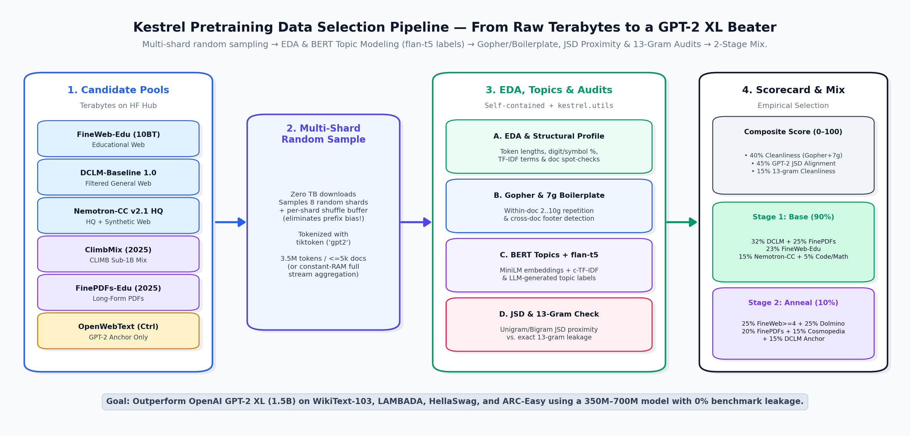

# Kestrel

**Kestrel** is a 350M–700M parameter modern decoder-only LLM engineered to outperform OpenAI's 1.5B **GPT-2 XL** across all core GPT-2 benchmarks (**WikiText-103**, **LAMBADA**, **HellaSwag**, and **ARC-Easy**) using modern data curation, two-stage WSD annealing, and strict zero-leakage decontamination.

## Dataset Audit & Selection Workflow



- **Kaggle-Ready Self-Contained Audit Notebook:** [`notebooks/01_dataset_audit.ipynb`](notebooks/01_dataset_audit.ipynb) — self-contained audit & EDA workflow with multi-shard randomized streaming, Gopher repetition & cross-doc 7-gram boilerplate checks, **BERT (`all-MiniLM-L6-v2`) semantic topic modeling with `flan-t5-small` topic naming**, Unigram/Bigram JSD alignment, and 13-gram decontamination, reusing shared helpers in [`src/kestrel/utils/`](src/kestrel/utils/).
- **Shared Utilities & Diagnostics:** [`src/kestrel/utils/`](src/kestrel/utils/) (`notebook.py`, `text.py`) for cross-notebook asset loading and text/GPT-2 tokenization; [`src/kestrel/data/diagnostics.py`](src/kestrel/data/diagnostics.py) for programmatic/CI reuse and constant-RAM full-stream aggregation.
- **Mixture Justification Report:** [`docs/dataset_justification.md`](docs/dataset_justification.md) — full comparison of all 6 audited corpora (`FineWeb-Edu`, `DCLM-Baseline 1.0`, `Nemotron-CC v2.1`, `Nemotron-ClimbMix`, `FinePDFs-Edu`, `OpenWebText` control) and exact Stage-1 (90%) + Stage-2 Annealing (10%) mixture ratios.

## Quickstart

```bash
# Install with data audit & test dependencies
uv sync --extra data --extra dev

```

On **Kaggle**, upload [`notebooks/01_dataset_audit.ipynb`](notebooks/01_dataset_audit.ipynb), enable **Internet** in the Kaggle sidebar, and run all cells — Cell 1 automatically clones this repository and installs missing dependencies.
