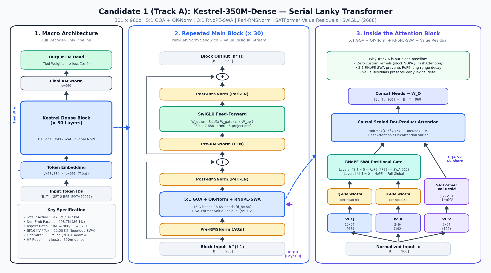
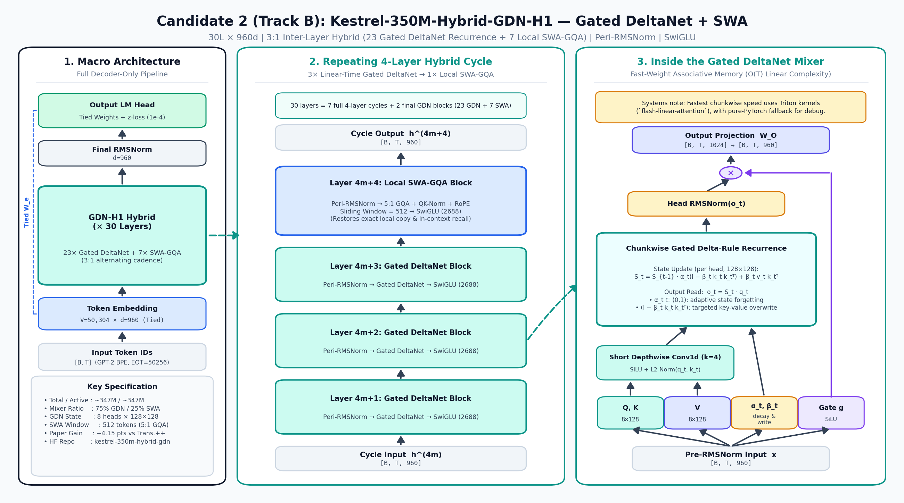
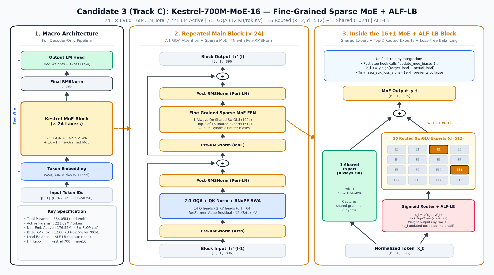
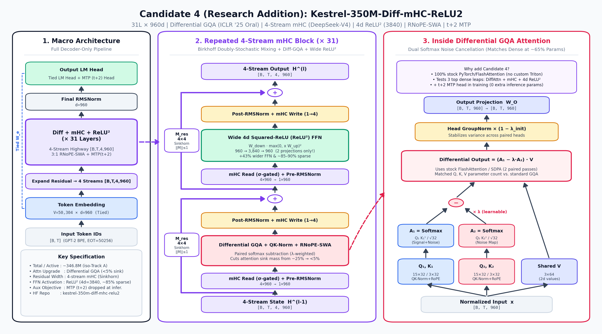

# Kestrel Candidate Architectures & Evaluation Protocol

All four candidate architectures share GPT-2's padded vocabulary (`V = 50,304`, Tensor Core multiple of 64), **tied embeddings** (leaving 86%–90% of parameters in core reasoning layers), **Peri-RMSNorm + QK-Norm**, and train through the exact same unified loop ([`src/kestrel/train.py`](../src/kestrel/train.py)) using **Muon + AdamW**, **WSD** scheduling, and **output z-loss (`1e-4`)**.

---

## 1. Candidate 1 (Track A): `Kestrel-350M-Dense`

* **Config:** [`configs/model/kestrel_350m_dense.json`](../configs/model/kestrel_350m_dense.json)
* **Design:** Lanky `30L × 960d` serial Transformer with 5:1 GQA, QK-Norm, 3:1 RNoPE-SWA (local RoPE sliding window 512 interleaved with global NoPE full attention), SATFormer Value Residuals (`V⁰ → Vˡ`), Peri-RMSNorm, and SwiGLU (`2688`).
* **Params / KV:** `~347.0M` total & active (`298.7M` non-embedding) | `22.50 KB/tok` BF16 KV cache (further bounded by SWA).



---

## 2. Candidate 2 (Track B): `Kestrel-350M-Hybrid-GDN-H1`

* **Config:** [`configs/model/kestrel_350m_hybrid_gdn.json`](../configs/model/kestrel_350m_hybrid_gdn.json)
* **Design:** `30L × 960d` inter-layer **Gated DeltaNet-H1** sequence-mixer hybrid alternating **3 Gated DeltaNet recurrence layers** (fast-weight delta-rule associative memory with adaptive forgetting $\alpha_t$ and selective overwrite $\beta_t$) with **1 local SWA-GQA layer** (`W = 512`), repeated across 30 layers (`23 GDN + 7 SWA`).
* **Params / Note:** `~347M` total & active; fastest chunkwise training uses `flash-linear-attention` Triton kernels.



---

## 3. Candidate 3 (Track C): `Kestrel-700M-MoE-16`

* **Config:** [`configs/model/kestrel_700m_moe16.json`](../configs/model/kestrel_700m_moe16.json)
* **Design:** `24L × 896d` iso-total fine-grained MoE with 7:1 GQA (`12.00 KB/tok` KV cache), **1 always-on shared SwiGLU expert** (`d_shared = 1024`), **16 routed SwiGLU experts** (`top-2`, `d_exp = 512`), and **Auxiliary-Loss-Free Load Balancing (ALF-LB)** updated post-step via `update_moe_biases()` in `train.py`.
* **Params / Compute:** `684.05M` total / **`221.62M` active** (`176.55M` non-embedding active — ~3× fewer non-embedding projection FLOPs/token than dense 700M).



---

## 4. Candidate 4 (Research Addition): `Kestrel-350M-Diff-mHC-ReLU2`

* **Config:** [`configs/model/kestrel_350m_diff_mhc_relu2.json`](../configs/model/kestrel_350m_diff_mhc_relu2.json)
* **Design:** 100% pure-PyTorch/FlashAttention frontier dense challenger iso-parameter to Track A (`31L × 960d`, `~346.8M` params) combining:
  * **Differential GQA** (ICLR 2025 Oral): subtracts a $\lambda$-weighted noise attention map from the primary map, shrinking BOS attention sinks from `~25%` to `<5%`.
  * **4-Stream Manifold-Constrained Hyper-Connections (`mHC`)** (DeepSeek-V4): expands the narrow `960d` residual stream to `4 × 960` with Sinkhorn-Knopp doubly-stochastic mixing (`||M|| ≤ 1`).
  * **Wide $4d$ ReLU² FFN (`3840`)**: drops the 3rd gating projection for a 43% wider hidden layer and `~85–90%` natural sparsity.
  * **Multi-Token Prediction (`t+2` MTP head)**: sharpens representation planning during pretraining and is discarded at inference (0 extra inference params).



---

## 5. How Evaluation Works (Two Strictly Separated Stages)

### A. During Pretraining — Test-Set-Blind Validation (`train.py`)
* Every `eval_interval` steps, `_evaluate()` scores the model on a **fixed, deterministic set of held-out `Nemotron-ClimbMix` validation batches** (`val_eval_batches`, separate random seed offset `10_000`) and logs `val/loss` and `val/ppl` (`exp(val_loss)`) against both `progress/tokens_seen` (iso-token) and `progress/gpu_hours` (iso-compute).
* No downstream benchmark data is ever touched during training or checkpoint selection (`best` checkpoint tracks lowest `val/loss`).

### B. Post-Training — Pinned `lm-evaluation-harness` vs. GPT-2 XL (7 Benchmarks)
1. **Stage 0 Reference Lock:** Run `openai-community/gpt2-xl` once on a pinned `lm-evaluation-harness` commit to lock exact apples-to-apples targets under identical prompt templates and byte-length normalization (`acc` and `acc_norm`):
   ```bash
   lm_eval --model hf \
     --model_args pretrained=openai-community/gpt2-xl \
     --tasks wikitext,lambada_openai,hellaswag,piqa,winogrande,arc_easy,arc_challenge \
     --batch_size auto
   ```
2. **How Each Benchmark Is Scored (Zero-Shot):**
   * **Language Modeling Perplexity (`WikiText-103`, stride 512):** Slides a causal window over raw test articles and measures exact token-level perplexity $\text{PPL} = \exp\left(-\frac{1}{N}\sum \log P(x_t \mid x_{<t})\right)$ (GPT-2 XL baseline: **`17.48`**). Because Kestrel uses GPT-2 BPE, perplexity is **100% apples-to-apples** with GPT-2 XL.
   * **Last-Word Prediction (`LAMBADA`):** Evaluates both perplexity and exact greedy accuracy on the final target word of narrative passages (GPT-2 XL baseline: **`8.63 PPL` / `63.24% acc`**).
   * **Multiple-Choice Log-Likelihood (`HellaSwag`, `PIQA`, `WinoGrande`, `ARC-Easy`, `ARC-Challenge`):** Computes $\sum \log P(\text{choice}_k \mid \text{context})$ for each candidate option and picks the highest-scoring choice—reporting both raw accuracy (`acc`) and length-normalized accuracy (`acc_norm`, dividing by byte length so shorter options aren't unfairly favored; GPT-2 XL HellaSwag baseline: **`50.9%`**).
3. **Evaluating Kestrel Checkpoints:** Pull any candidate straight from Hugging Face Hub (`pretrained=MohammedKamalAlsyd/kestrel-350m-dense,trust_remote_code=True`) on the exact same `lm_eval` command and log the final 7-benchmark scores back to the matching DagsHub MLflow run!
